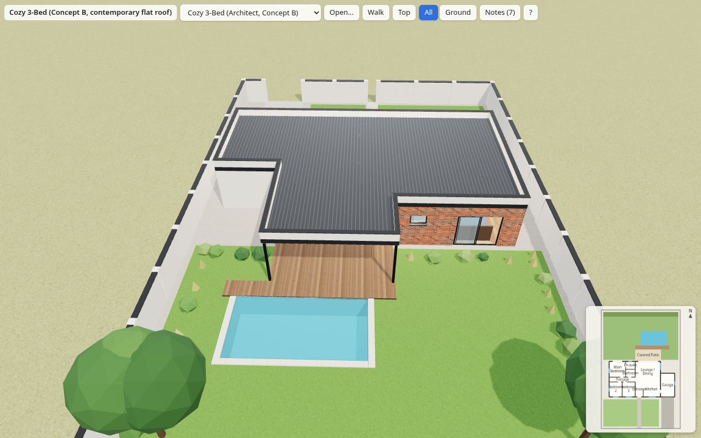
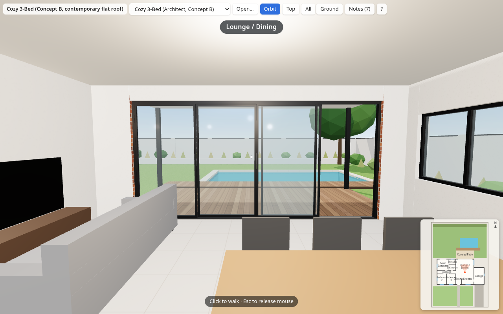
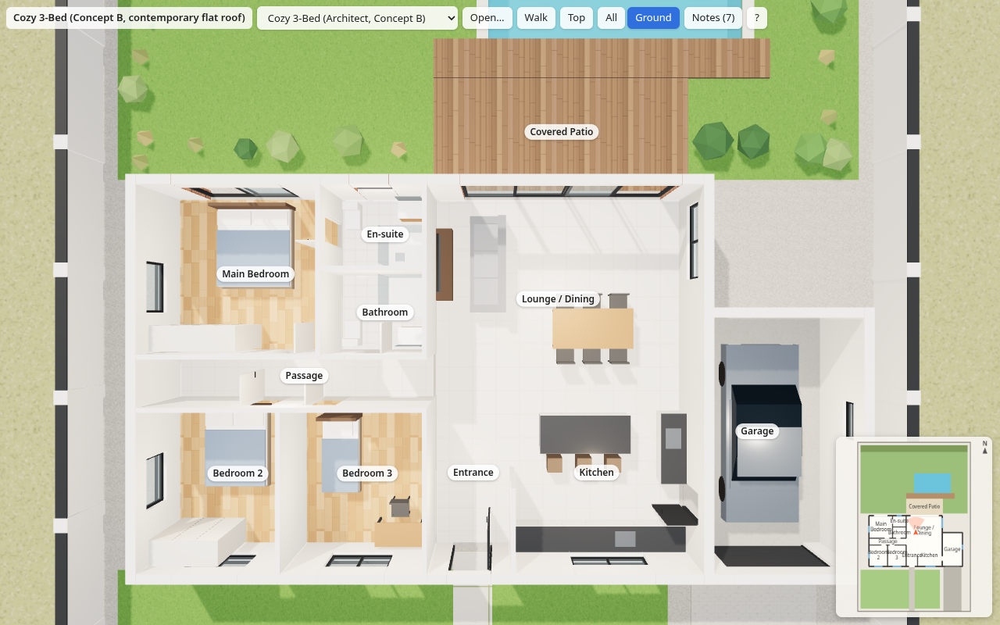
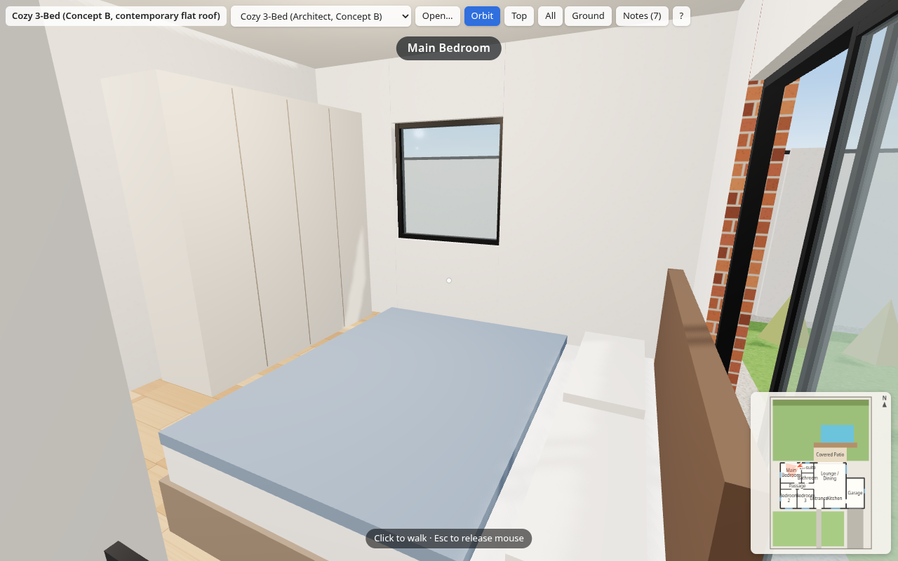

# Cozy 3-Bed House: Architecture Demo

A cozy single-storey ~145 m² three-bedroom contemporary house — Concept B: flat roof, face-brick feature wall, covered patio, timber deck, 6.5 × 3.5 m pool, single garage, on a 600 m² plot. Designed by an AI architect and turned into a browser walkthrough.









## Plans

- [Floor plan PDF](plans/cozy-3-bed-plans.pdf)
- [Plan JSON](plans/cozy-3-bed-plan.json)
- [JSON schema](plans/plan-schema.json)

The walkable viewer lives in [`viewer/`](viewer/) (see [viewer/README.md](viewer/README.md) and [viewer/SPEC.md](viewer/SPEC.md)). It builds a 3D house from the plan JSON.

## Live demo

[https://leonvanzyl.github.io/architecture-demo/](https://leonvanzyl.github.io/architecture-demo/)

The live demo goes live once GitHub Pages is enabled with source **GitHub Actions**.

## Run locally

```bash
cd viewer && npm install && npm run dev
```

Then open [http://localhost:5173](http://localhost:5173).

## Controls

- Click to walk
- WASD + mouse to move and look
- **V** — walk / orbit
- **T** — top-down
- **0–9** — level cutaway
- **H** — help
- Touch joystick on mobile

## Load another plan

- Add `?plan=URL` to the page address
- Use the **Open…** button
- Drag and drop a plan JSON onto the page
